# libmmd

A fast [Mermaid](https://mermaid.js.org) renderer written in C (`-std=gnu23`).
It turns Mermaid source into SVG. It works as a command-line tool (`mmd`) and as a small C library (`libmmd`).
It needs no browser, no Node.js, no JavaScript engine and no dependencies beyond libc and libm.

- About **0.6–1.6 ms per diagram from the CLI**. mermaid-cli takes about 0.9–1.6 s for the same diagrams (see [Benchmarks](#benchmarks)).
- Library renders take about **15 µs** for a small flowchart and about **0.5 ms** for a 4 KB one.
- Flowchart layout follows dagre's algorithm, so node positions match mermaid's closely (mean node-centre error 1.6 px on the fixture set).
- All 396 syntax examples from mermaid's documentation that mermaid itself can render also render here.

> **Status:** this is a young project. Output is meant to look like mermaid-cli 11.17, not to match it pixel for pixel. See [Status and limitations](#status-and-limitations).

## Supported diagram types

| Family | Keywords |
|---|---|
| Flowchart | `flowchart`, `graph` (all directions, subgraphs, per-subgraph `direction`, every node shape, markdown strings, `fa:` icons, edge ids and animation, `classDef`/`style`/`linkStyle`) |
| Sequence | `sequenceDiagram` (actors and participant types, boxes, activations, notes, loop/alt/opt/par/critical/break blocks, autonumber) |
| Class | `classDiagram`, `classDiagram-v2` |
| State | `stateDiagram`, `stateDiagram-v2` |
| Entity relationship | `erDiagram` |
| Gantt | `gantt` |
| Pie | `pie` |
| User journey | `journey` |
| Timeline | `timeline` |
| Mindmap | `mindmap` |
| Quadrant | `quadrantChart` |
| XY chart | `xychart`, `xychart-beta` |
| Git graph | `gitGraph` |
| C4 | `C4Context`, `C4Container`, `C4Component`, `C4Dynamic`, `C4Deployment` |
| Requirement | `requirementDiagram` |
| Architecture | `architecture`, `architecture-beta` |
| Block | `block`, `block-beta` |
| Sankey | `sankey`, `sankey-beta` |
| Packet | `packet`, `packet-beta` |
| Kanban | `kanban` |
| Radar | `radar`, `radar-beta` |
| Treemap | `treemap`, `treemap-beta` |
| ZenUML | `zenuml` (native renderer in ZenUML's style) |
| Ishikawa (fishbone) | `ishikawa`, `ishikawa-beta` |
| Cynefin | `cynefin`, `cynefin-beta` |
| Venn | `venn`, `venn-beta` |
| Tree view | `treeView`, `treeView-beta` |
| Swimlane | `swimlane-beta` |
| Event modeling | `eventmodeling` |
| Railroad | `railroad-beta`, `railroad-ebnf-beta`, `railroad-abnf-beta`, `railroad-peg-beta` |
| Wardley map | `wardley-beta` |

Every type also supports:
- the `default`, `dark`, `forest` and `neutral` themes;
- `%%{init}%%` and YAML front-matter config, with `themeVariables` values whitelisted;
- `accTitle`/`accDescr`, which become `<title>`/`<desc>` plus ARIA attributes.

Per-type feature notes are in [docs/INTERNALS.md](docs/INTERNALS.md).

## Build

You need a C compiler with C23 support:
- **clang** (the default; tested with clang 23);
- or **gcc 14**.

The Makefile builds with `-std=gnu23`. You also need GNU make. Python 3 is needed only for the test and benchmark scripts.

```sh
make                      # -> build/mmd, build/libmmd.{a,so}, build/mmd.pc, build/bench
make CC=gcc-14            # build with gcc instead
make MARCH=native LTO=1   # optional: tuned build
make pgo                  # optional: profile-guided build in build-pgo/
make install PREFIX=/usr/local   # header, static + shared lib, pkg-config file, mmd
```

The build has zero warnings under `-Wall -Wextra` with both gcc 14 and clang.

## CLI

```sh
build/mmd in.mmd -o out.svg
build/mmd -i in.mmd -o out.svg -t dark      # themes: default | dark | forest | neutral
cat in.mmd | build/mmd > out.svg            # stdin -> stdout
build/mmd in.mmd -o out.svg --no-avoid      # flowchart: skip obstacle re-routing (fastest)
```

On a syntax error the tool exits with a non-zero status and prints `line:col: message`.

## C library

The API is in [`include/mmd.h`](include/mmd.h):

```c
#include <stdio.h>
#include <string.h>
#include "mmd.h"

int main(void) {
    const char *src = "flowchart LR\n  A[Start] --> B{Ok?}\n  B -- yes --> C[Done]\n";
    mmd_buffer svg = {};
    mmd_error err = {};
    if (mmd_render_svg(strlen(src), src, nullptr, &svg, &err) != MMD_OK) {
        fprintf(stderr, "%u:%u: %s\n", err.line, err.col, err.message);
        return 1;
    }
    fwrite(svg.data, 1, svg.len, stdout);
    mmd_buffer_free(&svg);
}
```

```sh
cc -std=gnu23 -Iinclude example.c build/libmmd.a -lm      # or: $(pkg-config --cflags --libs mmd)
```

- `mmd_options` (which may be `nullptr`) sets node and rank spacing, font size, theme, and the `MMD_F_*` layout flags.
- For batch rendering, `mmd_context_new()` / `mmd_context_render_svg()` / `mmd_context_free()` reuse the arena and output buffer between calls. Use one context per thread.
- Errors come back as `mmd_status` together with `mmd_error` (code, 1-based line and column, message).
- The shared library exports only `mmd_*` symbols.

## Benchmarks

All numbers below were measured on the same 8-vCPU Intel Xeon VM. Times are wall-clock for a whole process run, including process start-up. Each value is the best of N runs: N = 20 for libmmd, 5 for mmdr and 3 for mmdc.

The tools compared are:
- `mmd`: this project;
- **mermaid-rs-renderer** (`mmdr` 0.3.1, Rust);
- **mermaid-cli** (`mmdc` 11.17.0, headless Chrome).

The run was made on 2026-10-23.

| input | libmmd CLI | mmdr CLI | mermaid-cli |
|---|---:|---:|---:|
| flowchart_small (mmdr fixture) | 0.59 ms | 29.1 ms | 917 ms |
| flowchart_medium (mmdr fixture) | 0.78 ms | 136.9 ms | 1064 ms |
| flowchart_large (mmdr fixture) | 1.56 ms | 436.6 ms | 1583 ms |
| flowchart_mega_event_mesh (mmdr fixture) | 0.96 ms | 1777.1 ms | 1017 ms |
| seq_full (tests/cases) | 0.59 ms | 3.2 ms | 860 ms |
| class_full (tests/cases) | 0.72 ms | 9.6 ms | 1124 ms |

Rendering in-process through the library, timed with `build/bench` (minimum over repeated renders, clang build, from [`bench/results_v14.txt`](bench/results_v14.txt) and [`bench/results_libmmd_inproc.txt`](bench/results_libmmd_inproc.txt)):

| input | size in → SVG out | time |
|---|---|---:|
| `bench/inputs/small.mmd` | 376 B → 9 KB | 14.9 µs |
| `bench/inputs/medium.mmd` | 4.4 KB → 80 KB | 527 µs |
| `bench/mmdr_fixtures/flowchart_large.mmd` | 6.4 KB → 75 KB | 214 µs |
| `bench/inputs/large.mmd` | 44 KB → 1.2 MB | 9.3 ms |
| `bench/inputs/xlarge.mmd` | 143 KB → 4.7 MB | 56 ms |

[`bench/results_fixtures.txt`](bench/results_fixtures.txt) has library and CLI times against mmdr for all 31 mmdr flowchart fixtures. To reproduce:

```sh
make && build/bench bench/inputs/medium.mmd 30
MMDR=/path/to/mmdr python3 bench/compare.py bench/mmdr_fixtures/*.mmd
```

mermaid-cli spends most of its time starting Chrome. Its per-diagram cost is lower when it renders many diagrams in one process. The comparison is still useful for the common case of one CLI call per diagram.

## Gallery: libmmd vs mermaid-cli

Each image puts libmmd on the left and mermaid-cli 11.17 on the right, rendered from the same source in `tests/cases/`. To regenerate them, run `python3 tools/gallery.py tests/cases/<name>.mmd`.

| | |
|---|---|
| Flowchart with subgraphs 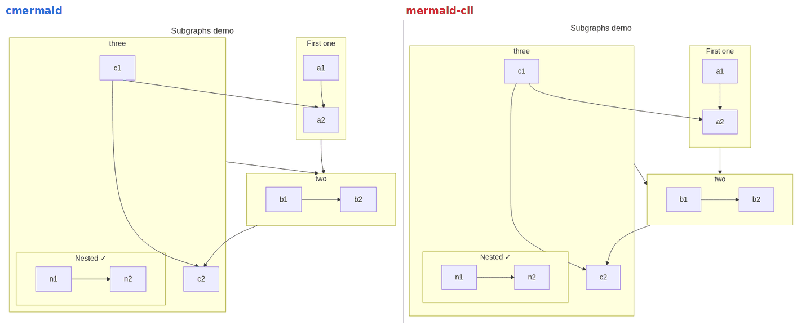 | Flowchart 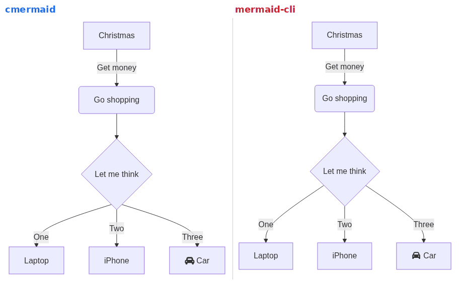 |
| Sequence 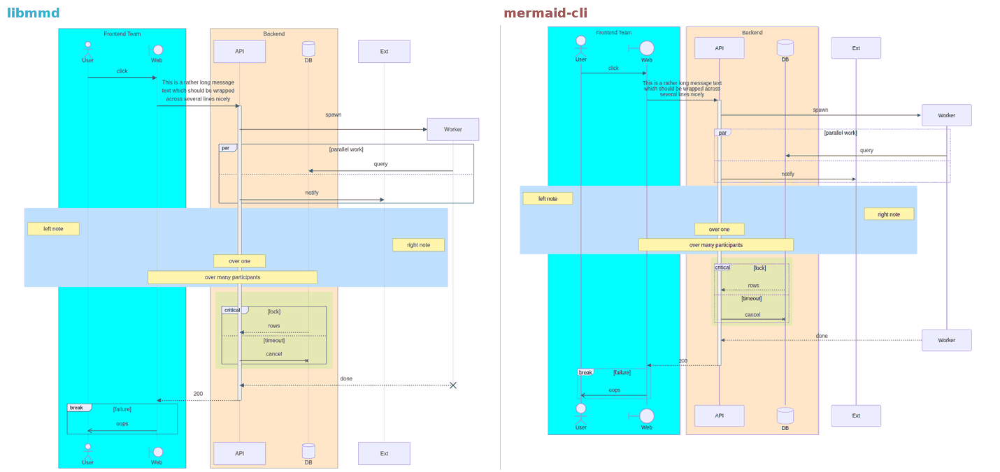 | Class 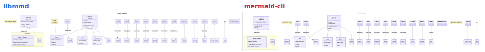 |
| State 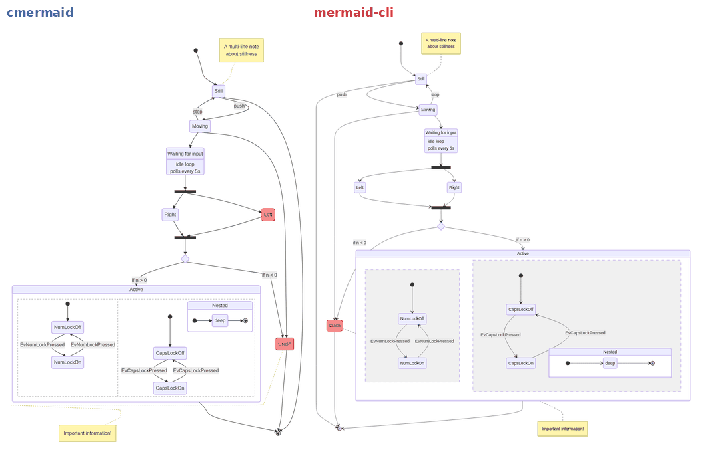 | ER 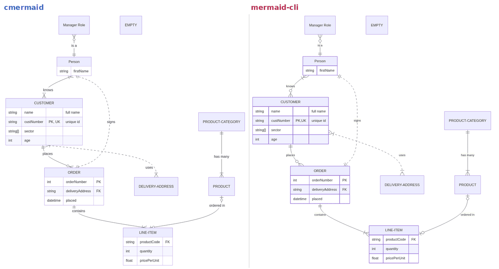 |
| Gantt 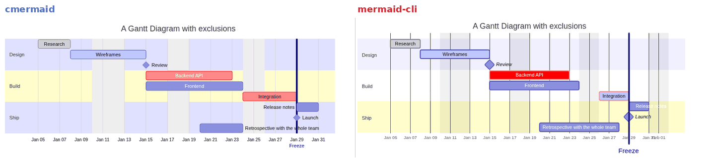 | Git graph 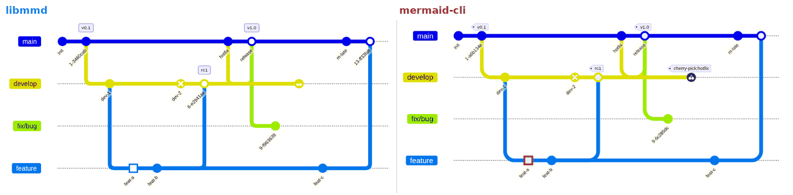 |
| Mindmap 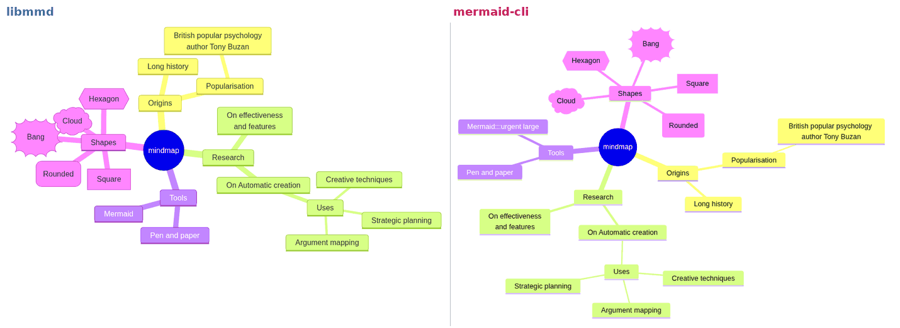 | Architecture 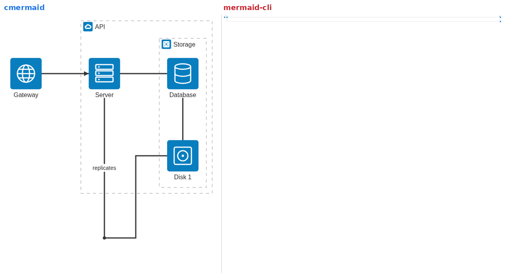 |
| C4 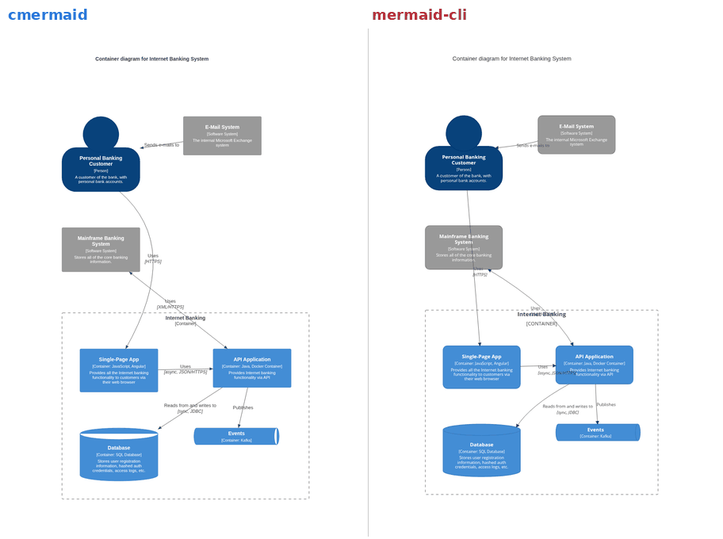 | Sankey 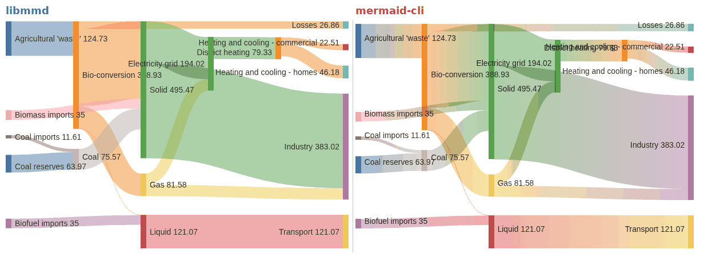 |
| Pie 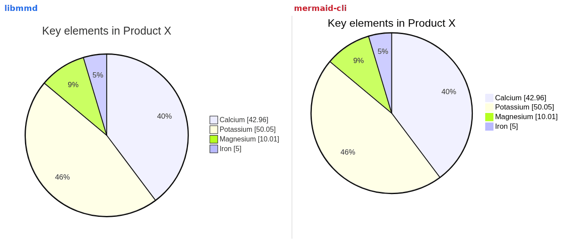 | Timeline 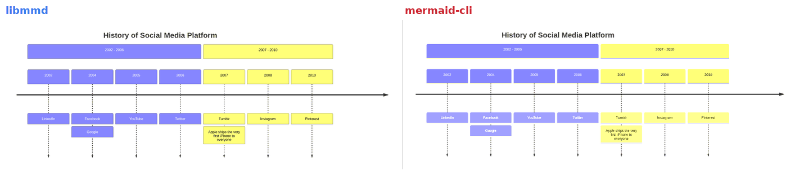 |
| XY chart 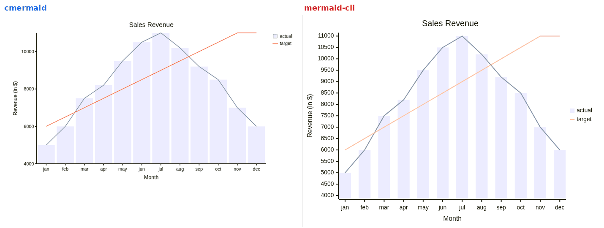 | Quadrant 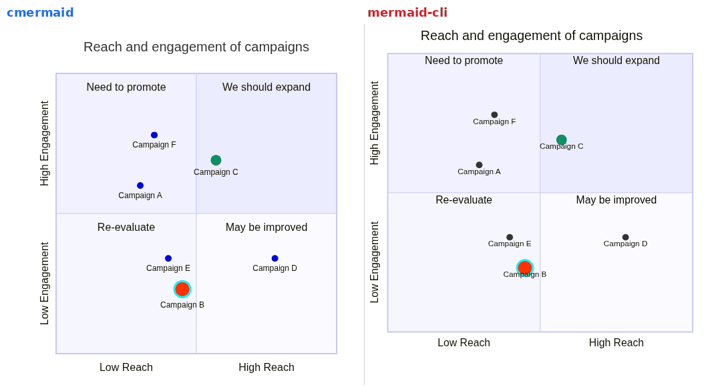 |
| Journey 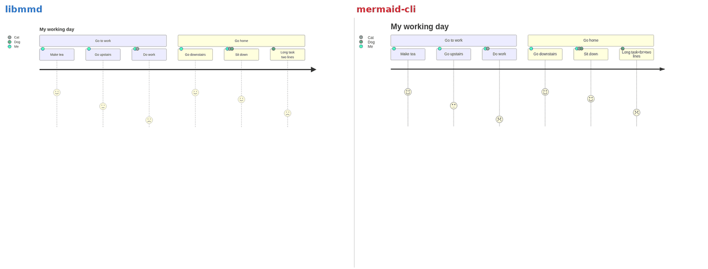 | |

More before/after pairs from development are in [`samples/sbs/`](samples/sbs).

## Testing and quality tooling

| what | how |
|---|---|
| Golden + sanity tests (150 cases; XML well-formedness, error positions, viewBox bounds, mermaid docs corpus) | `make test` (`UPDATE_GOLDEN=1 make test` to refresh) |
| Mermaid docs corpus: 432 examples from mermaid's syntax docs, 396/396 that mermaid itself renders | `python3 tools/docs_audit.py [-v]` |
| ASan + UBSan build | `make asan` → `build-asan/mmd` |
| Fuzzing (mutational, under ASan) | `python3 tests/fuzz.py build-asan/mmd 1000` |
| Allocation-failure injection | `sh tests/poison.sh` |
| Stress generator (every type, density 1×–5×) | `python3 tools/stress_gen.py OUT 2 SEED SCALE` |
| Visual quality scanner (edges through nodes, label overlaps, labels on edges, out-of-bounds…) | `python3 tools/quality_scan.py files… [-v]` |
| Layout agreement with mermaid (rank/cross-axis order, node-centre error) | `python3 bench/posagree.py` |
| Side-by-side ranking against mermaid-cli renders | `python3 tools/sbs_rank.py`, `tools/sbs_pair.sh` |
| Byte-identity check for perf work | `sh bench/eq/cmp.sh` |

## Status and limitations

- **Similar, not identical.** Output follows mermaid-cli 11.17 in style and, for flowcharts, in layout (mermaid/dagre ordering and ranking). Mermaid-generated CSS selectors and pixel-exact SVGs are not goals.
- **Mindmap** does not use mermaid's cose-bilkent layout. It uses its own radial and spring layout, so mindmaps look different from mermaid's.
- **Architecture** also has its own grid layout, not fcose.
- **Text** is measured with built-in Helvetica/Arial-compatible advance tables, not a real font engine. Unusual fonts and complex scripts can be sized imperfectly. CJK and emoji are treated as wide characters.
- **Very dense diagrams**, around 5× the stress generator's density, can still have label overlaps. This mostly affects Sankey, quadrant and Wardley charts on a fixed-size canvas.
- **Known differences** from mermaid include gantt tick density, state concurrent-region styling and journey legend order. See [docs/INTERNALS.md](docs/INTERNALS.md).
- **`fa:` icons** in flowcharts need the Font Awesome font where the SVG is viewed. Architecture and mindmap icons are embedded as paths.
- **Not supported:** interactivity (`click` callbacks, tooltips) and PNG/PDF output. To get a raster image, convert the SVG with any SVG rasteriser.

## License

MIT. See [LICENSE](LICENSE).

Embedded icon data comes from Font Awesome Free (CC BY 4.0) and simple-icons (CC0 1.0). See [THIRD_PARTY_NOTICES](THIRD_PARTY_NOTICES).

---

## 中文简介

libmmd 是一个用 C 语言（gnu23）编写的高速 Mermaid 渲染器，可作为命令行工具 `mmd` 或 C 库 `libmmd` 使用。它把 Mermaid 源码直接渲染成 SVG，不需要浏览器、Node.js 或任何第三方依赖。

- 支持上表列出的全部 30 多种图表类型。
- 单个图表的命令行渲染约 1 毫秒，mermaid-cli 约 1 秒。
- 流程图采用与 mermaid（dagre）一致的布局算法。

构建只需 `make`，用法为 `build/mmd in.mmd -o out.svg`。效果对比见上方 Gallery。

许可证：MIT（见 [LICENSE](LICENSE)）。内嵌图标数据来自 Font Awesome Free（CC BY 4.0）和 simple-icons（CC0 1.0），详见 [THIRD_PARTY_NOTICES](THIRD_PARTY_NOTICES)。
